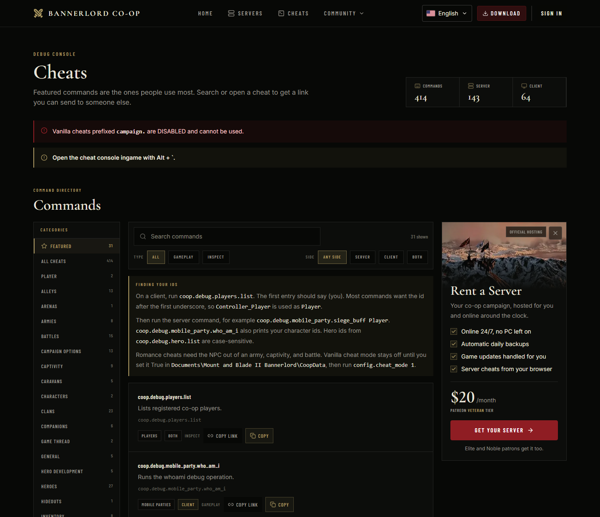
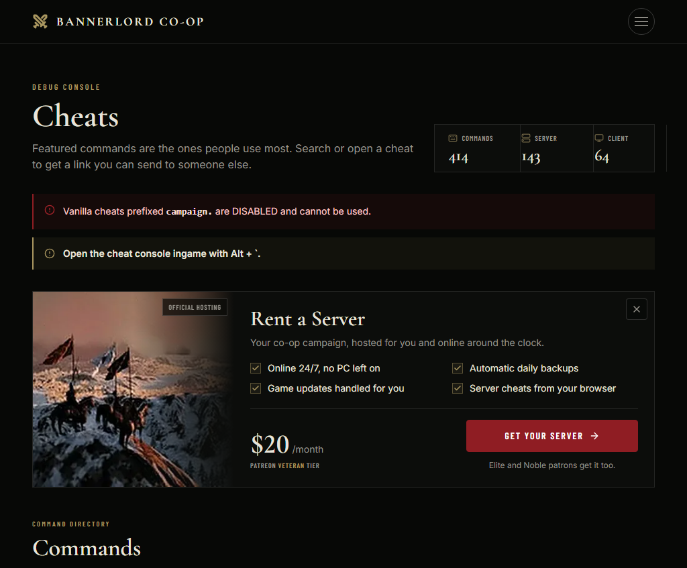
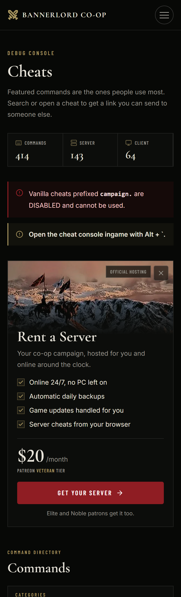

# Cheats hosting offer

The cheats page advertises managed hosting beside the command directory.

- **Placement.** From `xl` (1280 px), `CheatsDirectory`'s `aside` slot adds a 300 px third grid column beside the command list. Below `xl`, `CheatsView` renders the same offer inline after the console tip: stacked on phones, and as a horizontal banner from `sm`.
  - On viewports at least 50rem (800 px) tall, the column is sticky at `top-20`. The tallest locale's card (French, about 693 px) plus that 80 px offset still fits, so the card is never cut off. On shorter viewports it scrolls with the page.
  - The categories rail stays sticky too, and scrolls internally (`max-h` plus `overflow-y-auto`) so every category stays reachable.
  - Sticky works because `globals.css` clips root horizontal overflow (`overflow-x: clip`) instead of hiding it. Browsers without `clip` fall back to `hidden`, where sticky stays inert.
- **Link.** The call to action is the only click target. It opens the Patreon checkout for the $20 Veteran tier (`https://www.patreon.com/checkout/BannerlordCoop?rid=28995946`) in a new tab with `rel="noopener noreferrer"`. Its accessible name is the visible label plus a screen-reader note that Patreon opens in a new tab.
  - In the campaign's public tier listing (checked 2026-10-24), reward `28995946` is Veteran at 2,000 USD cents.
  - Elite and Noble memberships also fund one server allowance; see [Patreon allocation webhooks](patreon-allocation-webhooks.md).
- **Copy.** The `hostingOffer.*` keys live in every `cheats` dictionary and in the legacy zh-CN snapshot. The price is USD, formatted with `Intl` for the page locale. Patreon tier names stay untranslated.
- **Claims and their basis.** If the control plane changes any of these, update the copy:
  - *Always online:* automatic idle hibernation is off by default.
  - *Daily backups:* scheduled automatic backups run daily.
  - *Game updates:* Stable servers update in their maintenance window, and owners also have Update now.
  - *Server cheats from the browser:* the website console accepts any `coop.*` command.
- **Dismissal.**
  - The close button hides both placements.
  - It also writes `blcoop-hosting-offer=hidden` (`Path=/cheats`, `SameSite=Lax`, 30 days, `Secure` on HTTPS).
  - `page.tsx` reads that cookie, so a dismissed offer is absent from the server HTML and never flashes.
  - The page was already rendered dynamically.
- **Art.** `public/images/hosting/riders-band.webp` (600 × 320, about 30 KB) is served through `next/image` with `alt=""` and lazy loading.
- **Changing the offer.** Update `HOSTING_OFFER_CHECKOUT_URL`, `HOSTING_OFFER_TIER` and `HOSTING_OFFER_PRICE_USD` in `src/app/cheats/HostingOffer.tsx`, together with the `hostingOffer.finePrint` messages.

Production build (`next start`), signed out:

| Desktop, 1440 px | Tablet, 1024 px | Phone, 390 px |
| --- | --- | --- |
|  |  |  |
